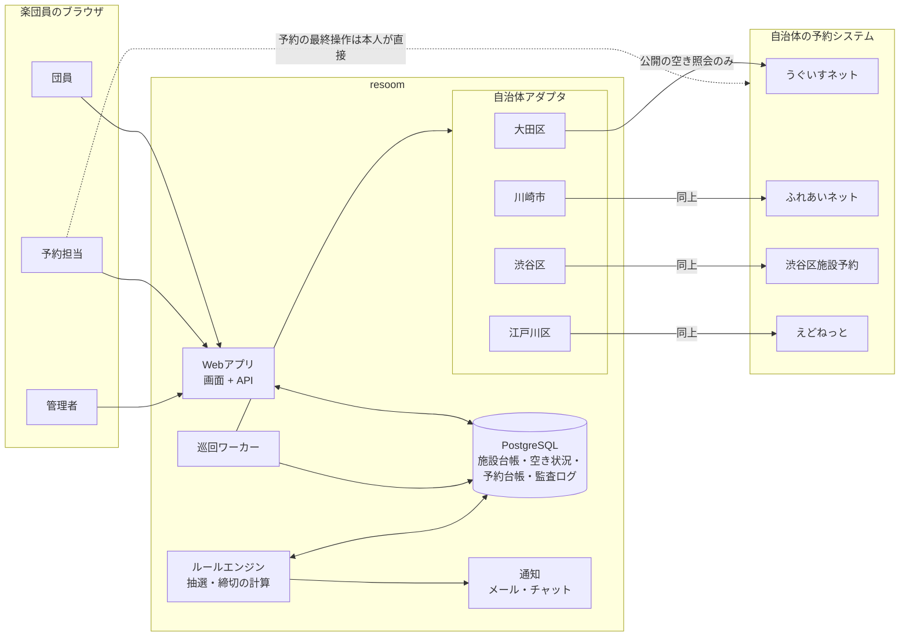
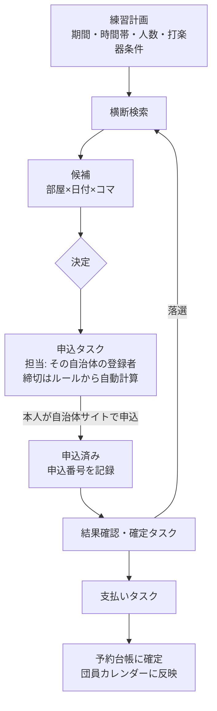

# resoom システム設計書（v0.1 ドラフト）

- 作成日: 2026-11-23
- 状態: たたき台。12章の「決めていただきたいこと」が埋まり次第 v1.0 にします。
- 表記: 一次資料（自治体の公式文書）を直接読んで確認したものは **[確認済]**、検索結果の要約のみで原文未確認のものは **[要確認]**、まだ分からないものは **[未確認]** と書きます。

---

## 1. 目的とスコープ

### 1.1 解決したい課題

吹奏楽団の練習会場を、大田区・川崎市・渋谷区・江戸川区の公共施設から探して予約する作業を楽にします。特に次の3つが人力では大変です。

1. **「器楽演奏可（打楽器含む）」の部屋だけを対象に、自治体をまたいで空き日程を探すこと。** 条件は自治体ごと・部屋ごとに違い、PDFの注意書きや電話確認でしか分からないものもあります。
2. **抽選・確定・支払いの締切管理。** 自治体ごとに日程とルールが違い、確定処理を忘れると当選が無効になる自治体もあります。
3. **自治体アカウントと予約状況の共有。** 誰のどの登録で何を予約したかが担当者の頭の中やメモに散らばりがちです。

### 1.2 やること

- 器楽・打楽器条件つきの施設カタログ（楽団の「施設台帳」）
- 4自治体の空き状況の横断検索
- 抽選・先着・確定・支払いの締切カレンダーと通知
- 練習計画から予約完了までのタスク管理と予約台帳
- 楽団員の権限管理（招待制）

### 1.3 当面やらないこと

- **抽選の大量申込や、先着開始時刻の「早押し」の自動化。** 公平性を損ない、規約違反・アクセス遮断の原因になります。
- **他人名義のアカウントのパスワードをサーバーに集めること。** 川崎市の規約で明確に禁止されています（2章）。
- 施設の使用料の決済代行。

---

## 2. 調査で分かった前提（2026-11-23 時点）

### 2.1 4自治体の比較

| | 大田区 | 川崎市 | 渋谷区 | 江戸川区 |
|---|---|---|---|---|
| システム名 | うぐいすネット | ふれあいネット | 渋谷区施設予約システム | えどねっと |
| URL | `www.yoyaku.city.ota.tokyo.jp` [確認済] | `www.fureai-net.city.kawasaki.jp` [確認済] | `www.yoyaku.city.shibuya.tokyo.jp` [確認済] | `www.shisetsuyoyaku.city.edogawa.tokyo.jp/user/` [確認済] |
| 空き照会 | 未登録でも閲覧可 [確認済] | 24時間可。ログイン要否は [未確認] | [未確認] | ログイン不要 [確認済] |
| 稼働時間 | 5:00〜翌1:59 [確認済] | 予約等は7〜24時 [確認済] | [未確認] | 原則24時間 [確認済] |
| 登録形態 | 個人（3年）／団体（2年） [確認済] | 個人のみ。団体登録は2022年3月末で廃止 [要確認] | 団体代表者が登録。区分1〜3・その他 [確認済] | 登録申請を区が承認。区分で表示が変わる [要確認] |
| ID・パスワードの共有 | 登録カードの譲渡・貸与は不可 [確認済]。パスワード共有の明文は [未確認] | **利用者番号・パスワードを他人に提供すること、他人のものを利用・収集することを禁止** [確認済] | 利用権の譲渡・転貸は不可 [確認済]。パスワード共有の明文は [未確認] | 利用者番号・パスワードの第三者への譲渡・貸与は不可 [確認済] |
| 自動アクセス | 明文は [未確認]。ログイン時に画像認証があるとの情報あり [要確認] | 「不正な手段でのアクセス」禁止。安定的・公正な運用を妨げる恐れがあればアクセス遮断 [確認済] | [未確認] | [未確認] |

### 2.2 抽選・締切ルールの例（公式資料から読み取ったもの）

| 自治体・施設 | 抽選申込 | 抽選日 | 確定・支払い | 先着予約 | 上限 |
|---|---|---|---|---|---|
| 大田区 集会施設 [確認済] | 利用月の4か月前の16日〜末日 | 翌月1日 | 2日〜7日に結果確認。**確定処理をしないと当選無効。** 支払いは同月15日まで | 同月9日から | 1登録で最大6コマ |
| 江戸川区 地域・文化施設 [確認済] | 毎月5日9時〜14日22時 | 15日 | 当選はそのまま予約になる。結果確認は抽選日正午〜月末 | 施設ごとに異なる | 音楽室は月5回・38時間 [要確認] |
| 渋谷区 文化総合センター大和田 練習室 [確認済] | 利用日の3か月前の月。区分ごとに3回 | 区分ごと | **確定処理が必要。** 最終日23時締切 | 3か月前の22日から | 申込8件・当選3件／月 |
| 川崎市 市民館の一部 [確認済] | 2027年3月の抽選から「抽選参加グループ」登録が必要な部屋がある | — | — | — | 申込できるのは登録グループのうち1名のみ |

渋谷区（大和田）には、利用7日前以降のキャンセルで30日間、無断キャンセルで90日間、抽選申込・仮予約ができなくなるペナルティがあります [確認済]。

### 2.3 器楽・打楽器条件の書かれ方の例

- 渋谷区 大和田 練習室: 「和太鼓等、音の響く太鼓の演奏、その他大音量の出る行為」は不可。「部屋により、防音性能が異なります。内容によっては、利用いただけない場合がございます」。大練習室は約95㎡・定員70人（ピアノを置いたコーラスを想定した人数）[確認済]
- 江戸川区: 「施設により様々な条件が付いている場合がありますので、初めて利用する施設には、あらかじめご相談いただくようにお願いします」[確認済]

つまり、条件は**構造化されていない文章**で書かれ、最終的には**施設への確認や実際の利用実績**でしか確定しません。予約システムの画面から機械的に取れる情報ではありません。

### 2.4 設計に効く3つの発見

1. **横断検索にパスワードは要りません。** 大田区と江戸川区は空き照会がログイン不要と確認できました。一番の困りごとである「打楽器可の部屋の空きを横断で探す」は、公開情報と楽団の施設台帳だけで作れます。
2. **川崎市は、パスワードを預かる方式がとれません。** 登録は個人単位で、番号・パスワードの提供と収集が規約で禁止されています。違反すると利用停止です。予約の最終操作は、登録した本人が自分で行う設計にします。
3. **川崎市のシステムは2027年3月16日に入れ替わります** [確認済]。現行システムは3月12日17時まで。新システムはSMSによる本人確認が入り、「不適正利用対策等の強化」がうたわれています。現行システム向けの作り込みは約4か月で使えなくなります。

---

## 3. 設計方針

1. **検索は公開情報だけで実現する。** 空き状況の取得にログインを使いません。
2. **予約は「本人操作モード」を基本にする。** システムは候補・手順・締切を示し、登録者本人が自治体サイトで操作します。自動化は、規約と自治体の見解を確認できた自治体から段階的に入れます。
3. **自治体サイトに負荷をかけない。** 巡回は対象の部屋だけ、低頻度、直列、キャッシュ前提にします（6.3）。
4. **器楽・打楽器条件は、根拠つきの台帳として人が育てる。** 出典・確認日・利用実績を必ず残します。
5. **自治体ごとの違いは、アダプタとルール定義に閉じ込める。** 川崎市の入れ替えや規則改定を、他の部分に波及させません。
6. **パスワードは「持たない」が第一選択。** 持つ場合も、Webアプリからは復号できない構造にします（9章）。

---

## 4. 全体アーキテクチャ



| コンポーネント | 役割 |
|---|---|
| Webアプリ | 検索・施設台帳・予約台帳・タスク・権限管理の画面とAPI。検索は常にDBに対して行い、利用者の操作で自治体サイトへ直接問い合わせることはしません |
| 巡回ワーカー | 定期的に各アダプタを呼び、空き状況をDBに保存します |
| 自治体アダプタ | 自治体ごとの画面構造の違いを吸収し、共通の形式に変換します |
| ルールエンジン | 抽選申込期間・確定期限・支払期限・先着開始日を計算し、タスクと通知を作ります |
| 通知 | 締切のリマインド、空きが出たときの通知を送ります |

将来、予約操作を自動化する場合は、ここに「予約ワーカー」と「資格情報保管庫」を独立した部品として足します（9.3）。

---

## 5. ドメインモデル

### 5.1 施設台帳と音出し条件

部屋（Room）ごとに、次の情報を持ちます。

| 項目 | 内容 |
|---|---|
| 基本 | 自治体、施設、部屋名、面積、定員、所在地、最寄駅 |
| 楽器区分ごとの可否 | 管楽器／小物打楽器／ドラムセット／大型打楽器（ティンパニ・バスドラム等）／和太鼓 のそれぞれに `可`・`条件付き`・`不可`・`未確認` |
| 条件の詳細 | 時間帯の制限（例: 21時以降は音出し不可）、音量に関する注意、同時利用の制約 |
| 設備 | 譜面台・椅子の数、ピアノ、備え付け打楽器、有料備品 |
| 搬入 | エレベーター、駐車場、搬入口、台車の可否 |
| 予約条件 | 利用できる登録区分（区内・区外、団体区分）、適用される予約ルール |
| 根拠（複数） | 種別（公式文書／電話確認／利用実績）、URL、引用、確認日、確認者 |

設計上の要点は次の4つです。

- **可否は直接書き換えず、根拠の記録から導く。** その楽器を名指しした記録があればその中で最も新しいものに、なければ楽器を限定しない最も新しい記録に従います。「ドラムセットは不可」と案内された部屋が、後日の別の記録で誤って「可」に戻らないようにするためです。
- **「未確認」を「不可」と区別する。** 検索では既定で「可」「条件付き」だけを出し、切り替えで「未確認」も出せるようにします。
- **利用実績を最も強い根拠として扱う。** 「2026年10月にティンパニ4台を搬入して利用、問題なし」のような記録を残せるようにします。
- **根拠には有効期限を持たせる。** 確認日から1年たった条件には「再確認が必要」と表示します。

定員は用途によって意味が違います（大和田の定員70人はコーラス想定）。そのため定員とは別に、**楽団として実際に入れる人数の目安**を部屋ごとに記録できるようにします。

### 5.2 空き状況

自治体によって時間割が違います（午前・午後・夜間の3区分、1時間単位など）。保存時に**開始時刻と終了時刻を持つコマ**に正規化します。

| 項目 | 内容 |
|---|---|
| 部屋・日付・開始時刻・終了時刻 | 正規化したコマ |
| 状態 | `空き`／`予約済`／`抽選受付中`／`受付前`／`休館・保守`／`不明` |
| 取得日時 | 画面に「何分前の情報か」を必ず表示します |

### 5.3 予約ルール

2.2 のような日程と上限を、コードではなく**データ**として持ちます。規則改定のたびに改修しなくて済みます。

- 抽選申込期間（利用月の何か月前の何日〜何日、時刻）
- 抽選日、結果確認期間、確定処理の要否と期限
- 支払期限と方法（窓口／オンライン）
- 先着予約の開始日
- 申込・当選・利用時間の上限
- キャンセル期限とペナルティ
- 出典と適用開始日

### 5.4 自治体アカウント

| 項目 | 内容 |
|---|---|
| 自治体、名義人（団員）、登録種別（個人／団体）、区分（区内・区外など） | 誰がどの自治体で何を申し込めるか |
| 登録の有効期限 | 更新期限のリマインドに使います（大田区は個人3年・団体2年、川崎市は3年） |
| 資格情報の扱い | `保持しない`（既定）／`保管庫` |

利用者番号は個人に紐づく情報なので、保存する場合は項目単位で暗号化します。

### 5.5 練習計画から予約までの流れ



- タスクには自治体サイトへのリンクと、施設・日付・コマの指定内容を表示します。担当者はそれを見ながら自分のログインで操作します。
- 各タスクの期限前に通知します。確定処理や支払いの期限切れを防ぐのが目的です。
- 予約台帳は自治体横断の一覧です。団員向けにはカレンダー（iCalendar形式の配信）でも見られるようにします。

### 5.6 主なテーブル

| テーブル | 内容 |
|---|---|
| `members`, `roles`, `invitations` | 団員と権限 |
| `municipalities`, `facilities`, `rooms` | 施設台帳 |
| `room_sound_policies`, `policy_evidences` | 楽器区分ごとの可否と根拠 |
| `reservation_rules` | 抽選・締切ルール |
| `availability_slots`, `crawl_runs` | 空き状況と巡回の記録 |
| `municipal_accounts` | 自治体アカウント（名義人・有効期限） |
| `practice_plans`, `candidates` | 練習計画と候補 |
| `booking_tasks`, `reservations` | タスクと予約台帳 |
| `watches` | 空き監視の条件 |
| `audit_logs` | 監査ログ（追記のみ） |

将来ほかの楽団でも使えるように、主要テーブルには楽団ID（`organization_id`）を持たせます。当面は1楽団だけで運用します。

---

## 6. 自治体アダプタ

### 6.1 共通インターフェース

```ts
interface MunicipalityAdapter {
  readonly id: 'ota' | 'kawasaki' | 'shibuya' | 'edogawa';
  // 稼働時間・巡回間隔などの制約
  readonly constraints: AdapterConstraints;
  // 指定した部屋・期間の空き状況を取得する（ログインなし）
  fetchAvailability(room: RoomRef, range: DateRange): Promise<RawSlot[]>;
  // 利用者を自治体サイトの該当画面へ案内するリンクを作る
  buildDeepLink(target: BookingTarget): string | null;
}
```

予約操作（ログイン・申込・確定・取消）のメソッドは、自動化を入れる段階になってから別インターフェースとして追加します。

### 6.2 取得方式

- まず通常のHTTP取得とHTML解析で実装します。画面がJavaScript前提で取得できない場合だけ、ヘッドレスブラウザ（Playwright）を使います。
- 各サイトの画面を保存した**フィクスチャ**でテストします。開発やCIで自治体サイトへ繰り返しアクセスしないためです。
- 画面構造が変わったら検知できるように、解析に失敗した巡回は「不明」として保存し、管理者に通知します。

### 6.3 巡回ポリシー

| 項目 | 方針 |
|---|---|
| 対象 | 施設台帳で「可」「条件付き」の部屋だけ（数十部屋の想定）。全施設は巡回しません |
| 頻度 | 既定は数時間に1回。利用者による手動更新は、部屋ごとに一定時間に1回まで |
| 送り方 | サイトごとに直列。リクエスト間に数秒の間隔 |
| 時間帯 | 各システムの稼働時間内だけ。先着開始時刻の前後に集中させません |
| 異常時 | エラーが続いたら自動で停止し、管理者に通知します |
| 礼儀 | robots.txt に従います。連絡先を明示した User-Agent を使うかは要判断です |

川崎市の規約は、安定的・公正な運用を妨げる恐れのあるアクセスを遮断できるとしています。同市では2020年に、同一IPから24時間で約2万件の申込みがあり、受付を紙に切り替えた事例があります [要確認]。この方針は、そうした扱いを受けないための最低線です。

### 6.4 川崎市の扱い

- 現行システムは2027年3月12日で終了します。**アダプタは新システムの稼働後（2027年3月16日以降）に作る**ことを提案します。
- それまでは、施設台帳・ルール・タスク・予約台帳の機能だけを川崎市にも適用します。空き状況は自治体サイトへのリンクで補います。
- 練習会場に市民館の体育室・大会議室を使っている場合は、「抽選参加グループ」の登録（2026年11月11日受付開始）が必要になる可能性があります。

---

## 7. 横断検索

### 7.1 入力

| 条件 | 例 |
|---|---|
| 期間・曜日 | 2027年3月の土日祝 |
| 時間帯 | 13:00〜21:00 のうち連続4時間以上 |
| 人数 | 45人 |
| 打楽器条件 | 大型打楽器（ティンパニ）まで可 |
| 自治体・エリア | 4自治体すべて |
| 条件の確からしさ | 「可」「条件付き」のみ／「未確認」も含める |

### 7.2 出力

日付ごとに、条件に合う部屋とコマを並べます。各行に次の表示を付けます。

- **今すぐ先着予約できる**／**抽選申込できる（締切日）**／**受付開始前（開始日）**
- 楽団の誰の登録で申し込めるか
- 打楽器条件の根拠（出典と確認日）
- 空き状況の取得時刻

### 7.3 ログインなしで使える検索ページ（実装済み）

空き状況の検索（`/search`）は、**ログインなしで使えます**（楽団の判断。2026-11-23）。

- 検索ページは、定期実行の取得処理（`pnpm crawl`）が保存したデータだけを読みます。利用者の操作で自治体サイトに問い合わせることはありません。誰でも開けるページから問い合わせが飛ぶと、自治体サイトへの負荷やアクセス遮断の原因になるためです。
- 表示するのは、空きコマ・定員・楽器ごとの可否（可・条件付きなど）・公式の予約サイトへのリンクだけです。**記録の文面や記録者の名前は出しません。**
- 条件は、期間・曜日・時間帯（午前・午後・夜間。コマの開始時刻で分けます）・人数・使いたい楽器・自治体です。自治体の選択肢は、空き状況を自動で集めている自治体だけです（選んでも結果が出ない自治体は紛らわしいため。2026-11-23）。
- 曜日の欄には「祝日」もあります（振替休日・国民の休日を含む。`packages/core/src/holidays.ts` で計算し、内閣府の一覧と同じになることをテストで確かめています）。選んだ曜日のどれか、または祝日に当てはまる日を出します。祝日の日には、見出しに祝日の名前を出します。
- 最初に開いたときは、曜日は土・日・祝、使いたい楽器は和太鼓以外（管楽器・小物打楽器・ドラムセット・大型打楽器）、「可否が未確認の部屋も含める」はオン、自治体はすべてを選んでおき、外していく形にします（2026-11-23）。フォームから送られた条件は、すべて外した場合も含めてそのまま使います（隠し項目 `s=1` で見分けます）。
- 条件を変えると、検索ボタンを押さなくても結果を更新します（チェックはすぐ、日付と人数は入力が止まってから）。スクリプトが動かないときは、検索ボタンで検索できます。
- 結果の上に、情報の最終取得時刻（集めた時刻のうちいちばん新しいもの）を出します。部屋ごとの取得時刻は「Data coverage」にあります。
- 一覧しやすいよう、結果は日付ごとに1部屋1行で出し、上に日付の目次（その日に空いている部屋の数つき）を置きます。楽器ごとの可否は記号（✓ 可・△ 条件付き・✕ 不可・? 未確認）と色で示し、凡例を添えます。
- ページの一番上に、空き状況を自動で集めていない自治体を理由ごとにまとめて出します（2026-11-23 追加）。理由は `apps/web/app/search/not-searched.ts` で自治体ごとに決めています。
  - robots.txt が機械的なアクセスを認めていない（江戸川区・目黒区）
  - 新システムまで停止中（川崎市）
  - まだ対応していない（文京区・江東区）
  - 上のどれでもないのにデータがない部屋は「今はデータがない」（未取得や取得失敗）
- 自動で集めていない部屋のうち条件（人数・楽器）に合うものは、自治体の選択にかかわらず、検索結果とは別の灰色の枠に、自治体ごとの部屋名の一覧として出します。「これは検索結果ではありません」と明記し、自治体ごとに予約サイトへのリンクを付けます（検索結果の行と見分けがつくようにするため）。
- 部屋ごとに、データの範囲と取得日時を出します。
- 7.2 の「今すぐ予約できるか」「誰の登録で申し込めるか」は、予約ルールと自治体アカウントの機能ができてから加えます。

### 7.4 空き監視

条件を保存しておくと、巡回のたびに照合し、キャンセルなどで空きが出たら通知します。取得頻度は 6.3 のままで、監視のために巡回を増やすことはしません。

---

## 8. 権限管理

### 8.1 ロール

| 操作 | ゲスト（ログインなし） | 団員 | 施設編集 | 予約担当 | 管理者 |
|---|:-:|:-:|:-:|:-:|:-:|
| 空き状況の検索（7.3） | ○ | ○ | ○ | ○ | ○ |
| 施設台帳（記録の文面・記録者を含む）・予約台帳の閲覧 | — | ○ | ○ | ○ | ○ |
| 練習計画の作成・候補への意見 | — | ○ | ○ | ○ | ○ |
| 施設台帳・音出し条件の編集 | — | — | ○ | ○ | ○ |
| 予約ルールの編集 | — | — | — | ○ | ○ |
| 申込タスクの作成・完了、予約の記録・取消 | — | — | — | ○ | ○ |
| 自治体アカウントの登録（自分の名義） | — | — | — | ○ | ○ |
| 団員の招待・ロール変更 | — | — | — | — | ○ |
| 監査ログの閲覧 | — | — | — | — | ○ |

- 権限の判定は必ずサーバー側で行います。
- 予約担当は、**自分が名義人の自治体アカウントに関するタスクだけ**を完了できます。
- 管理者は2人以上置くことを推奨します。

### 8.2 認証（実装済み: Google アカウント・招待制）

- **Google アカウントでログイン**します（Better Auth を使用）。resoom 自体はパスワードを持ちません。
- **招待制**です。管理者が楽団員の名簿（`members`）にメールアドレスを登録した人だけがログインできます。名簿にないアカウントは、作成もセッションの開始も止めます。名簿から外すと、ログイン中のセッションも消えます。
- 最初の管理者は、環境変数 `ADMIN_EMAILS` で名簿に入れます。
- いまのロールは、団員（閲覧）・施設編集（施設台帳の編集）・管理者（名簿の管理）の3つです。予約担当は、予約ルールと自治体アカウントの機能を作るときに加えます。最後の管理者は外せません。
- 権限の判定は、ページの表示とサーバー側の処理（フォームの送信）の両方で行います。
- 短時間に何度もログインを試すと、一時的に断ります（Better Auth のレート制限）。
- ローカルの開発・確認用に、メールアドレスとパスワードのログインがあります（`RESOOM_DEV_LOGIN=1`）。本番（`DATABASE_URL` がある環境）では、指定にかかわらず使えません。
- 多要素認証と、重要な操作の直前の再認証は、Google アカウント側の設定に任せます。自治体アカウントの機能を作るときに見直します。

---

## 9. セキュリティ設計

### 9.1 守るものと脅威

| 守るもの | 主な脅威 | 対策 |
|---|---|---|
| 自治体アカウントのパスワード | 漏えい、内部の不正利用、規約違反による利用停止 | 既定では保持しない（9.2）。保持する場合は 9.3 |
| 団員の個人情報 | 漏えい | 最小限だけ保存、項目単位の暗号化、権限による表示制御 |
| 予約そのもの | 誤操作・なりすましによる取消、無断キャンセルによるペナルティ | 権限、再認証、監査ログ、通知 |
| 自治体サイトとの関係 | 過剰アクセスによる遮断 | 6.3 の巡回ポリシー |

### 9.2 自治体アカウントのパスワードの扱い

3段階に分け、自治体ごとに選びます。

| レベル | 内容 | 適用 |
|---|---|---|
| 1. 保持しない（既定） | 名義人が自分のブラウザで自治体サイトにログインして操作します。resoom は手順・リンク・締切を示すだけです | 全自治体の初期状態。川崎市は恒久的にこれ |
| 2. 端末内だけで補助 | 名義人のブラウザで動く拡張機能が、名義人自身のログイン状態を使って入力を補助します。パスワードはサーバーに送りません。最終確定は人が押します | 規約を確認できた自治体で検討 |
| 3. サーバーの保管庫 | 暗号化して保存し、予約ワーカーが自動でログインします | 団体登録で、かつ自治体に確認が取れた場合のみ |

担当者どうしでパスワードを**共有・引き継ぎするだけ**なら、保管庫を自作せず、既存のパスワード管理ツールの共有機能を使うことを推奨します。自作の保管庫が必要になるのは、サーバーが自動でログインする場合（レベル3）だけです。なお、共有自体が規約で許されるかは自治体ごとに確認が必要です。

### 9.3 保管庫の設計（レベル3を採用する場合）

- **二重の鍵で暗号化します。** パスワードごとに使い捨てのデータ鍵（AES-256-GCM）で暗号化し、そのデータ鍵をクラウドの鍵管理サービス（KMS）の鍵で包みます。KMS の鍵は外に取り出せません。
- **Webアプリは暗号化しかできません。** 復号の権限は予約ワーカーだけに与えます。Webアプリが侵害されても、パスワードは取り出せません。
- **書き込み専用にします。** 登録後は誰も画面で見られません。できるのは差し替えと削除だけです。
- **使うたびに記録し、名義人に通知します。** 誰の指示で、いつ、何の予約に使ったかを監査ログに残します。
- **ログイン失敗時は再試行しません。** アカウントロックを避けるためです。
- **ログ・スクリーンショット・トレースに秘密を残しません。**
- 名義人の退団時や委任の取り消し時は、すぐに削除します。

### 9.4 アプリ自体の対策

- 通信は常時 HTTPS。セッション Cookie は `HttpOnly`・`Secure`・`SameSite`
- CSRF 対策、入力検証、出力エスケープ、レート制限
- 巡回ワーカーの接続先は、自治体の固定ホストだけに制限
- 監査ログは追記のみ。変更・削除はできません
- クラウドの権限は部品ごとに最小限。秘密情報はソースコードや環境変数の平文に置きません
- 依存パッケージの脆弱性チェックを継続的に実行
- データベースのバックアップは暗号化

### 9.5 個人情報

保存するのは、氏名（表示名）、連絡先、ロール、自治体アカウントの名義情報だけにします。退団時の削除手順を決めておきます。

---

## 10. 技術スタックと運用基盤（提案）

| 層 | 提案 | 理由 |
|---|---|---|
| 言語 | TypeScript（Node.js 22） | 画面・API・巡回を1言語で書けます。開発環境に最初から入っています |
| Web | Next.js | 画面とAPIを1つのアプリで持てます |
| データベース | PostgreSQL | 関係の多いデータに向いています |
| HTML解析 | 標準の fetch と cheerio。必要な場合だけ Playwright | 軽く、サイトへの負荷も小さくできます |
| テスト | Vitest（フィクスチャ）、Playwright（画面の結合テスト） | 自治体サイトにアクセスせずにテストできます |
| 構成 | 1リポジトリに複数パッケージ（pnpm workspaces） | アダプタを自治体ごとに分けられます |

リポジトリの構成案:

```
apps/web            画面とAPI
apps/worker         巡回・通知のジョブ
packages/core       ドメインモデル、検索、ルールエンジン
packages/adapters   ota / kawasaki / shibuya / edogawa
packages/db         スキーマとマイグレーション
fixtures            保存した画面（テスト用）
docs                設計書
```

### 10.1 運用基盤（2026-11-23 決定）

アクセスが少ない前提で、**無料枠の範囲で運用します**。

| 用途 | サービス | 費用 |
|---|---|---|
| 画面（Webアプリ） | Google Cloud Run（東京リージョン） | 無料枠内 |
| 空き状況の定期取得 | Cloud Run ジョブ ＋ Cloud Scheduler（1日数回） | 無料枠内（Scheduler は3ジョブまで無料） |
| データベース | **Neon**（PostgreSQL）の無料プラン | 無料（1GB・月100時間分の処理） |
| ログイン | Google アカウント（招待制） | 無料 |
| 秘密情報（接続文字列など） | Secret Manager | 無料枠内 |

- Google Cloud には、無料枠だけで使う場合も支払い方法の登録が必要です。使いすぎで自動的に止まる仕組みはないため、予算の通知（月100円など）を設定し、Cloud Run の最大インスタンス数を低くします。
- Cloud SQL は無料枠がない（最小構成で月9ドル台から）ため使いません。Supabase は無料プランだと1週間使われないと停止するため使いません。
- しばらく誰も使っていないと、最初の表示に数秒かかります（費用を0にするための引き換え）。
- 自治体サイトには、Cloud Run の送信元（Google のIPアドレス）から問い合わせます。開発環境（海外のIPアドレス）からも各自治体サイトに問い合わせられたので、東京リージョンは必須ではありません。

**川崎市の自動取得は、新システムの開始（2027年3月16日）まで見送ります**（2026-11-23 決定）。送信元のIPアドレスを固定する仕組み（Cloud NAT）が必要で月4ドル前後かかるうえ、今のシステムは3月12日で終わるためです。それまで川崎市の部屋は、検索ページ上部の案内と、検索結果とは別の「自動で検索していない自治体の部屋」の枠に出します。

---

## 11. 開発フェーズ

| フェーズ | 内容 | 完了の目安 |
|---|---|---|
| 0. 調査と合意 | 各システムの空き照会画面の構造、robots.txt、未確認の規約を調べる。対象の部屋を洗い出す。必要なら自治体の所管課に問い合わせる | 2.1 の表の [未確認] がなくなる |
| 1. 施設台帳と横断検索 | ログイン・権限、施設台帳、音出し条件、大田区と江戸川区のアダプタ、横断検索 | 「打楽器可・45人・来月の土日午後」で2自治体の空きが一覧できる |
| 2. 締切と予約台帳 | 予約ルール、タスク、通知、予約台帳、カレンダー配信、渋谷区のアダプタ | 抽選申込から支払いまでの期限が自動で通知される |
| 3. 空き監視と日程調整 | 空き監視、候補への意見集約、登録有効期限のリマインド | キャンセルで出た空きが通知される |
| 4. 川崎市の新システム対応 | 2027年3月16日以降に調査し、アダプタを作る | 4自治体で横断検索できる |
| 5. 予約操作の補助・自動化 | 9.2 のレベル2・3を、確認が取れた自治体から | 自治体ごとに判断 |

フェーズ1〜3だけで、1.1 の3つの課題はすべて扱えます。「Webで完結」のうち、**予約の最終操作だけは当面、自治体サイトで本人が行う**形になります。

---

## 12. 未確定事項

### 12.1 決めていただきたいこと

1. **各自治体の登録の現状。** 誰の名義で、個人登録か団体登録か。特に川崎市は本人操作が前提になります。
2. **対象の部屋。** 今よく使う部屋と、打楽器可と分かっている部屋の一覧。施設台帳の初期データにします。
3. **楽団の規模と打楽器。** 合奏の人数、ティンパニなど大型打楽器の搬入の有無。
4. **運用基盤。** Google Cloud でよいか。既存のアカウントの有無。
5. **通知手段。** メール、LINE、Slack、Discord のどれを使うか。
6. **自治体の優先順位。** 提案は、大田区 → 江戸川区 → 渋谷区 → 川崎市（新システム稼働後）。

### 12.2 リスクと未確認事項

| 項目 | 状況 | 対応 |
|---|---|---|
| 江戸川区の空き照会 | robots.txt が空き照会のページへの機械的なアクセスを認めていません（[調査メモ](./edogawa-investigation.md)） | 自動取得は行わない。区に問い合わせるか、手動確認の施設として扱う |
| 渋谷区の規約、空き照会のログイン要否 | 未確認 | フェーズ0で確認 |
| 大田区のシステム内規約、ログイン時の画像認証 | 未確認 | フェーズ0で確認 |
| 機械的な空き照会を自治体がどう見るか | 明文の許可はありません | 巡回ポリシーを守る。可能なら所管課に問い合わせる |
| 画面構造の変更 | いつでも起こりえます | フィクスチャと失敗検知で早く気づく |
| 規則の改定 | 毎年のように起こります | ルールをデータで持ち、出典と適用日を残す |

この文書の規約の読み取りは、法的な助言ではありません。判断に迷う点は、各自治体の所管課への確認をお勧めします。

---

## 13. 参考資料

- 川崎市 [公共施設利用予約システム利用規約](https://www.fureai-net.city.kawasaki.jp/web/pdf/kiyaku.pdf)
- 川崎市 [利用者カードの貸与・譲渡等は禁止です](https://www.fureai-net.city.kawasaki.jp/PDF/%E7%A6%81%E6%AD%A2%E4%BA%8B%E9%A0%85.pdf)
- 川崎市 [「ふれあいネット」をリニューアルします（2026年11月10日 報道発表）](https://www.city.kawasaki.jp/templates/prs/cmsfiles/contents/0000191/191364/houdou.pdf)
- 川崎市 [市民館施設の抽選申込方法が変更になります（2026年11月10日 報道発表）](https://www.city.kawasaki.jp/templates/prs/cmsfiles/contents/0000191/191601/20261110houdouhappyou.pdf)
- 大田区 [うぐいすネット利用案内](https://www.city.ota.tokyo.jp/shisetsu/uguisunet_annai/ugu.html)
- 江戸川区 [えどねっと利用ガイド ver.31](https://www.city.edogawa.tokyo.jp/documents/1845/edonet-riyoguide_ver31_2.pdf)
- 渋谷区文化総合センター大和田 [練習室 利用案内（2025年7月版）](https://shibu-cul.jp/cms/wp-content/uploads/2025/07/renshu_usage_guide2025.pdf)
- ScanNetSecurity [野球場予約フォームへ登録を遙かに超えるアクセス、紙による受付へ変更（川崎市）](https://scan.netsecurity.ne.jp/article/2020/10/16/44696.html)
